<p align="center">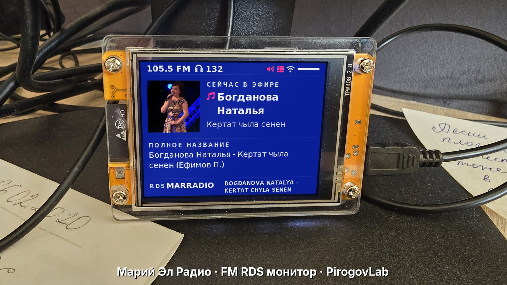</p>

<h1 align="center">📻 FM RDS монитор «Марий Эл Радио» 105.5 FM</h1>

<p align="center">
  <b>ESP32-2432S028 (Cheap Yellow Display) + RRD-102 v2.0 (RDA5807M) + LVGL</b><br>
  Настольный монитор эфира: RDS, «сейчас звучит» с фото исполнителя, слушатели онлайн и светодиод-статус.<br>
  Проект <a href="https://pirogovlab.ru">PirogovLab</a> · автор — Михаил Пирогов
</p>

<p align="center">
  
  
  
  
</p>

> **EN summary.** A desktop FM/RDS monitor for the Mari El Radio station (105.5 MHz, Yoshkar-Ola) built from an ESP32-2432S028 “Cheap Yellow Display” and an RRD-102 (RDA5807M) FM module. LVGL UI shows RDS PS and RadioText, the current track (trimmed exactly like the official Mari El Radio app) with artist photo, the full raw title, total internet listeners, Wi‑Fi and signal status. A rear RGB LED glows green when everything is fine and flashes red/blue on any fault. No buttons, Wi‑Fi is configured via a captive portal. MIT licensed.

## ✨ Возможности

- **RDS**: название станции (PS) отдельной строкой и RadioText в две строки на всю ширину; длинный RDS — подпись «RDS» сверху, PS ниже.
- **«Сейчас звучит»** — исполнитель и песня, обрезанные так же, как в приложении «Марий Эл Радио», с **фото исполнителя** (iTunes → сайт станции → логотип).
- **Полное название** со скобками (ремиксы, версии, «(feat. …)») — из `tv.metr12.ru/schedules/mer.txt`.
- **Слушатели онлайн** — суммарно по Марий Эл Радио и МЕТР 12 (Icecast `status-json.xsl`).
- Весь текст виден целиком: без многоточий, без бегущей строки и без мерцания.
- Заставка при запуске: проект, разработчик, PirogovLab.
- **Без кнопок**: частота зафиксирована на 105.5 МГц, экран повёрнут на 180°.
- **Wi‑Fi в любом месте**: запоминает до 5 сетей, при отсутствии известной поднимает портал `MariRadio-Setup`.
- **RGB-светодиод на задней стороне**: ровный зелёный — всё хорошо, «полицейская мигалка» красный/синий — неисправность.
- Сторожевой таймер и автопереподключение для работы 24/7.

## 📸 Скриншоты

| Заставка | Сейчас звучит | Сейчас звучит |
|:-:|:-:|:-:|
| 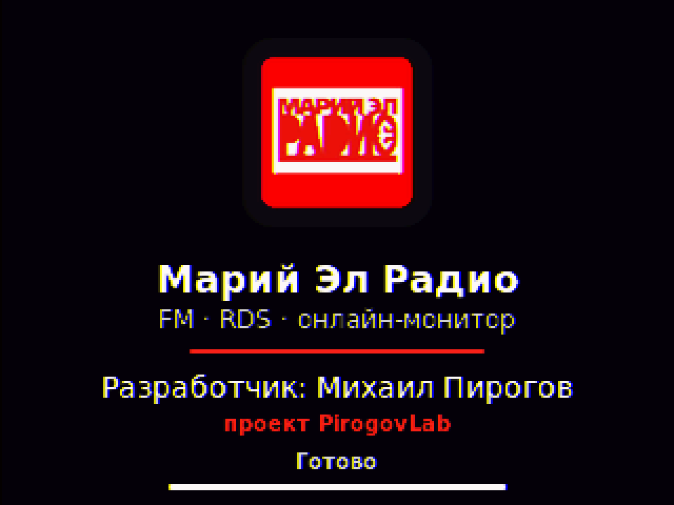 | 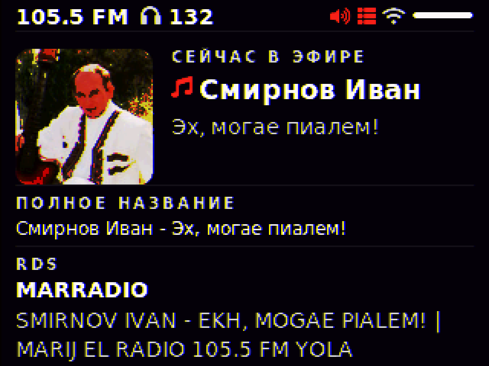 | 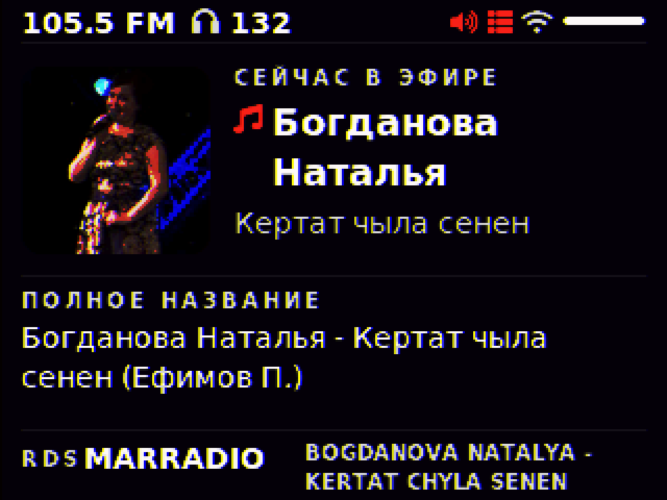 |
| 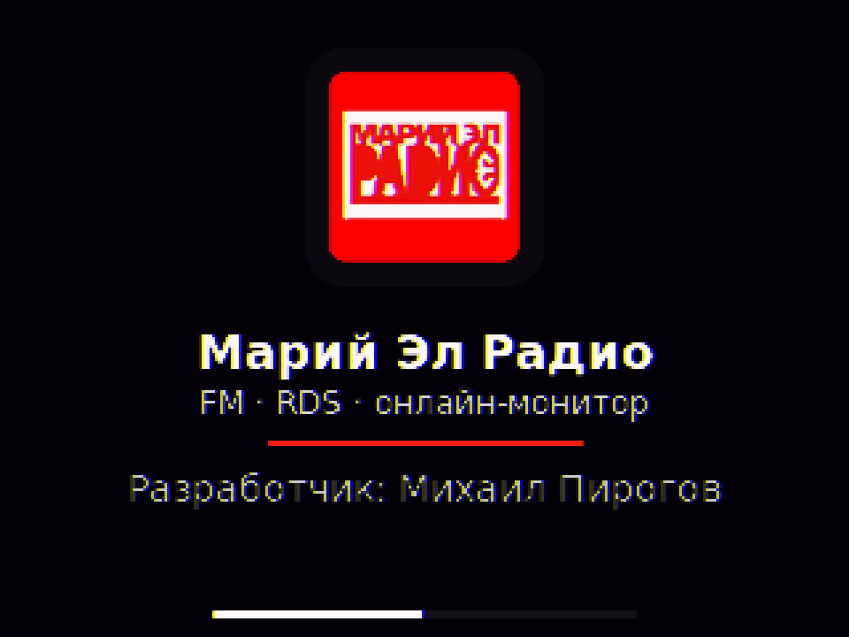 | 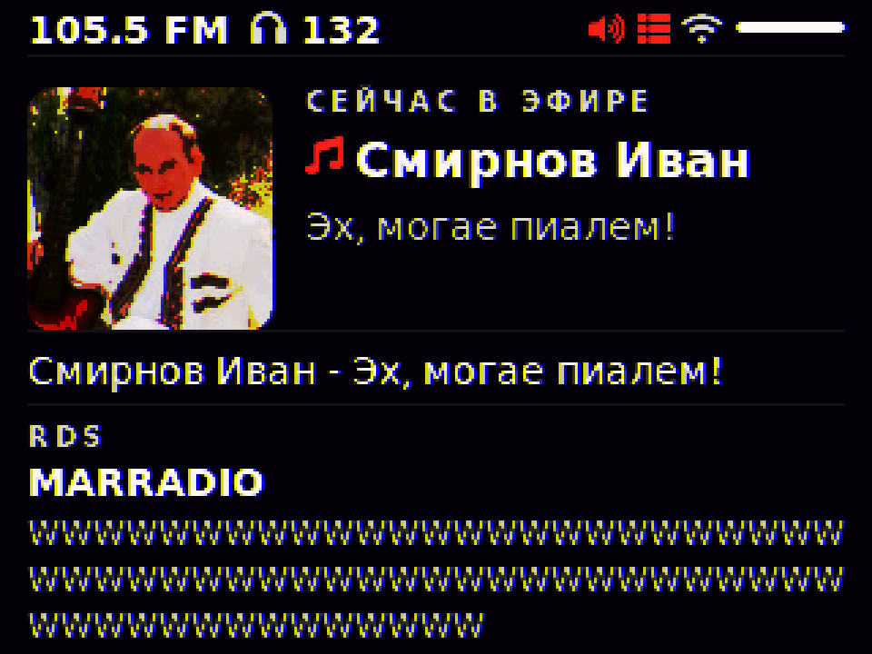 | 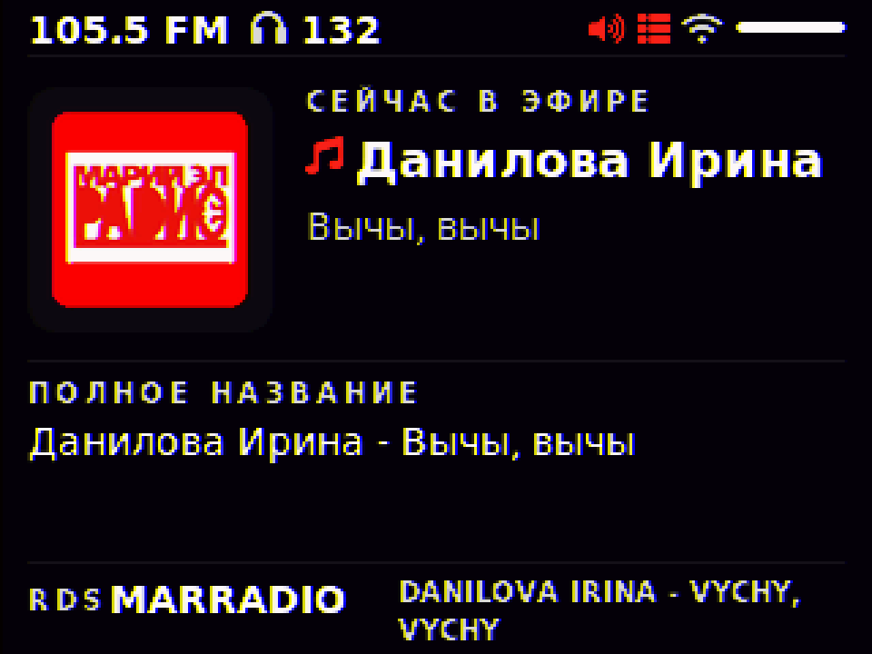 |

<p align="center">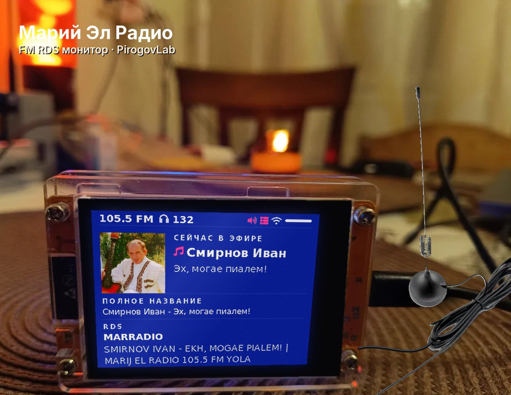 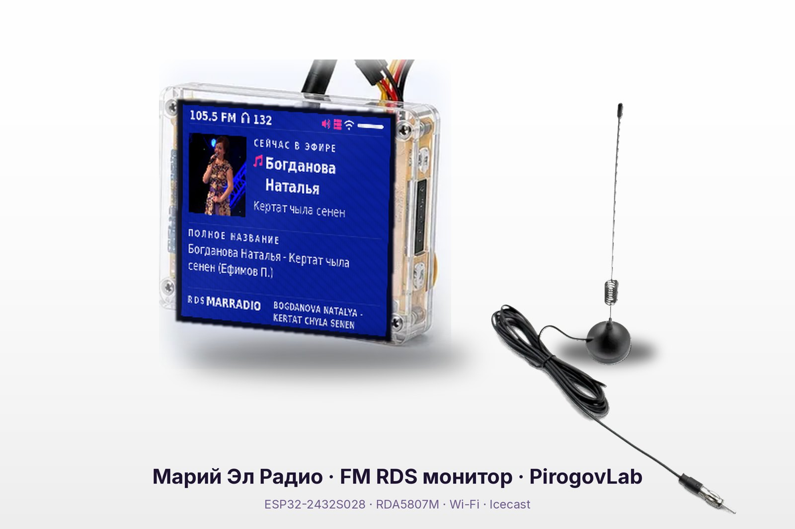</p>

## 🧩 Комплектующие

| Деталь | Примечание |
|---|---|
| ESP32-2432S028 (CYD) | 2.8" ILI9341 320×240, XPT2046, RGB LED |
| RRD-102 v2.0 | FM-приёмник на RDA5807M с RDS |
| FM-антенна | магнитная, на разъём ANT модуля |
| 4 провода | от разъёма CN1 платы CYD |
| Корпус | акрил (по желанию) |

## 🔌 Подключение

Разъём **CN1** на CYD → модуль RRD-102:

| Провод CN1 | Сигнал ESP32 | RRD-102 |
|---|---|---|
| 🔴 красный | 3V3 | VCC (5) |
| 🟡 жёлтый | IO27 | SDA (1) |
| 🔵 синий | IO22 | SCL (2) |
| ⚫ чёрный | GND | GND (6) |
| антенна | — | ANT (10) |

<p align="center">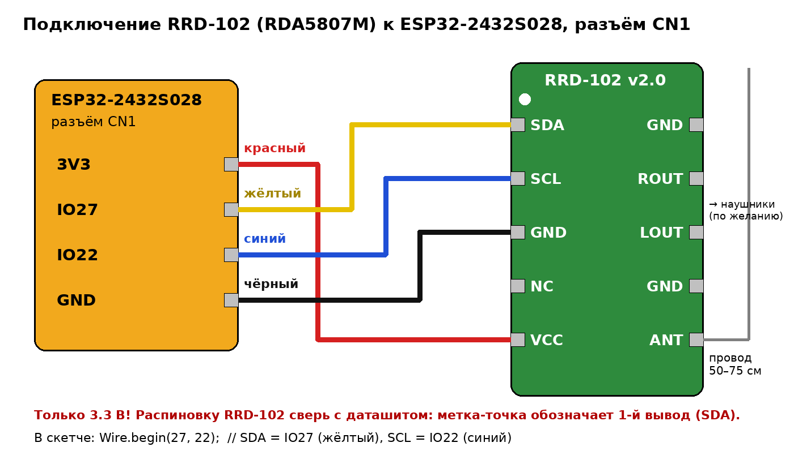 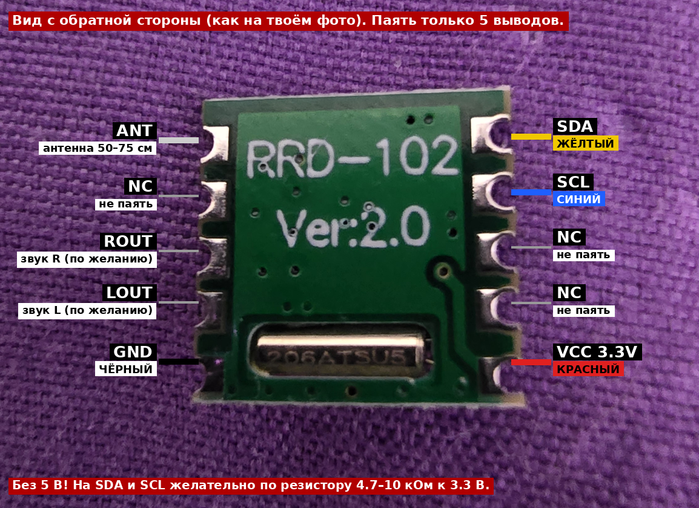</p>

Выводы RRD-102 (со стороны чипа, кварц снизу): слева 1 SDA, 2 SCL, 3 NC, 4 NC, 5 VCC; справа 10 ANT, 9 NC, 8 ROUT, 7 LOUT, 6 GND.

## 📚 Библиотеки

- [LVGL](https://github.com/lvgl/lvgl) **8.3.11**
- [TFT_eSPI](https://github.com/Bodmer/TFT_eSPI)
- [PU2CLR RDA5807](https://github.com/pu2clr/RDA5807)
- [ArduinoJson](https://arduinojson.org/)
- [TJpg_Decoder](https://github.com/Bodmer/TJpg_Decoder)
- [WiFiManager](https://github.com/tzapu/WiFiManager)

Конфигурации: `libconf/User_Setup.h` → в папку TFT_eSPI, `libconf/lv_conf.h` → рядом с папкой `lvgl`.

## 🛠 Сборка и прошивка

```bash
cp mer_radio_cyd/secrets.example.h mer_radio_cyd/secrets.h   # впишите свою сеть Wi‑Fi
arduino-cli compile --fqbn esp32:esp32:esp32:PartitionScheme=huge_app mer_radio_cyd
arduino-cli upload  --fqbn esp32:esp32:esp32:PartitionScheme=huge_app -p COM3 mer_radio_cyd
```

Важно: схема разделов **huge_app**; панель требует `invertDisplay(true)` (`PANEL_INVERT 1`); I²C работает на 50 кГц с контролем частоты и перенастройкой.

## 📶 Wi‑Fi в новом месте

Если ни одна сохранённая сеть недоступна, устройство поднимает точку доступа **`MariRadio-Setup`**. Подключитесь к ней с телефона, выберите сеть и введите пароль — она сохранится (до 5 сетей, новые первыми).

## 🚦 Светодиод

| Состояние | Значение |
|---|---|
| 🟢 ровный зелёный | Wi‑Fi, поток, RDS — всё в порядке |
| 🔴🔵 мигает красный/синий | нет Wi‑Fi, нет данных, слабый сигнал или ошибка приёмника |

GPIO4 — красный, GPIO16 — зелёный, GPIO17 — синий (активный низкий уровень).

## ⌨️ Команды в Serial (115200)

| Команда | Действие |
|---|---|
| `S` | дамп экрана |
| `W` | принудительно отключить Wi‑Fi (тест переподключения) |
| `F` | вкл/выкл имитацию неисправности (тест светодиода) |
| `D0`–`D5` | демо-треки (`D0` — вернуть реальные данные) |
| `Pnn` | кадр заставки на `nn×100` мс |
| `L` | список сохранённых сетей |

## 📄 Лицензия

[MIT](LICENSE) © 2026 Михаил Пирогов, [PirogovLab](https://pirogovlab.ru)
